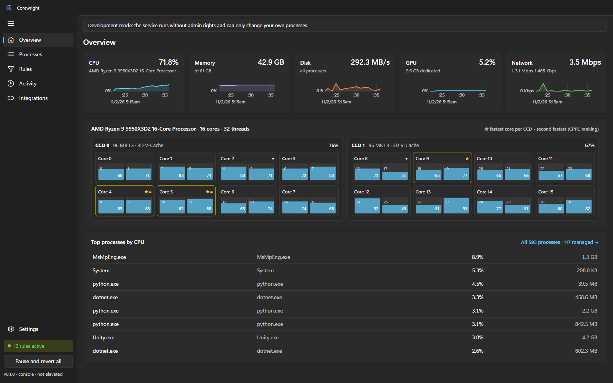
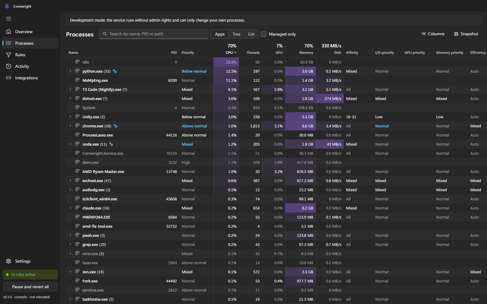
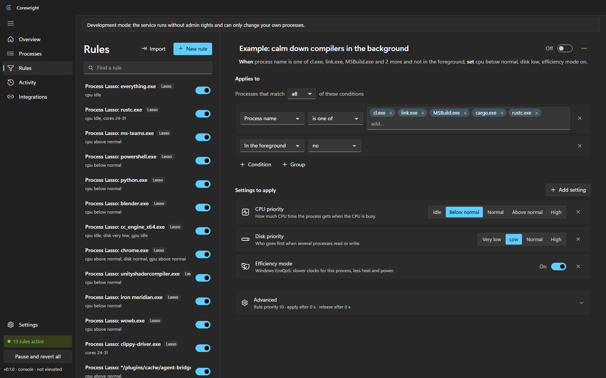
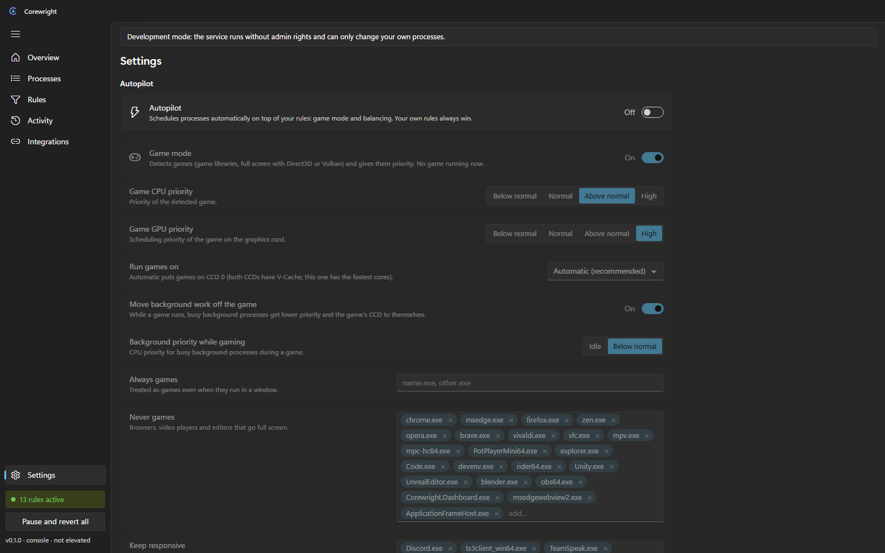

<p align="center">
  
</p>

<h1 align="center">Corewright</h1>

<p align="center">
  <b>A Windows process manager with a real rule engine.</b><br>
  CPU, I/O, GPU and memory priority, core placement, efficiency mode and memory caps,<br>
  decided by rules you can read, with an Autopilot for games and background work.
</p>

<p align="center">
  
</p>

## Why Corewright

Tools like Process Lasso set fixed values per process. Corewright decides with **rules**: conditions on anything you can see in the process list (name, path, command line, parent, CPU or memory use, foreground, facts pushed by other apps) and actions on every setting Windows offers. Each setting is owned by the highest-priority rule that sets it, and **when no rule claims a setting any more, Corewright puts the original value back**. Nothing stays changed by accident.

And it stays out of the way: the service idles at **0.01 % CPU and about 17 MB of memory** (NativeAOT build, measured), and the window costs nothing while it is closed.

## Features

| | |
|---|---|
| **Every setting, one engine** | CPU priority, CPU cores (affinity), I/O priority, GPU priority, memory priority, efficiency mode (EcoQoS), a hard memory cap (job object) and a soft RAM cap. |
| **Rules that explain themselves** | A rule builder in plain language, sustain and release timing against flapping, and an "Explain" view per process: which rule set what, and which rules were overruled. |
| **Autopilot** | Game mode: detects games (game libraries, full screen with Direct3D or Vulkan, your own list), gives them priority and the right CCD, moves busy background work off it and keeps voice chat responsive. Balancing: ProBalance-style restraint of background CPU hogs. All of it is just low-priority rules, so your rules always win. |
| **Knows your CPU** | CCDs, 3D V-Cache, physical cores and SMT threads, and the fastest cores by the CPPC ranking (the same ★ and • Ryzen Master shows). Rules can target `ccd0`, `vcache-ccd`, `best-cores:4`. |
| **Task Manager depth** | Apps, tree and list views, heat-map columns, every Task Manager column (command line, user, working sets, commit, I/O counters, GDI objects, …), GPU per process, resizable columns. |
| **Process Lasso import** | One click imports your `prolasso.ini`, including command-line patterns, and lists what Corewright cannot express yet. |
| **Built for integration** | A local HTTP API with a bearer token: read processes and system data, edit rules, push facts such as `obs.recording = true` that rules can react to. |
| **Native Windows 11 look** | Light and dark theme, your accent colour, Segoe UI Variable and Fluent icons, a title bar drawn into the app, a tray icon with a modern menu. |

<table>
  <tr>
    <td></td>
    <td></td>
  </tr>
  <tr>
    <td align="center"><b>Processes</b>: every setting a rule can change is a column; rule-set values are highlighted.</td>
    <td align="center"><b>Rules</b>: plain-language conditions and settings cards.</td>
  </tr>
  <tr>
    <td></td>
    <td align="center" valign="middle">
      <br><br>
      <b>Settings</b>: Autopilot game mode and balancing,<br>start with Windows, service status.
    </td>
  </tr>
</table>

## Quick start

Requirements: Windows 11 (Windows 10 works), the .NET 10 SDK, Node.js and the Visual Studio C++ build tools (for NativeAOT).

```bat
build.bat
```

`build.bat` stops a running Corewright, builds everything into `artifacts\publish\` and starts it: the service (Windows asks for admin rights so it can manage every process), the tray icon and the window. Afterwards `start.bat` starts it again and rebuilds automatically when the sources changed. Tray icon → **Exit Corewright** stops everything; every change Corewright made is reverted.

An installer that registers Corewright as a Windows service with tray autostart is in progress (`installer/`, see `docs/INSTALL.md` once it lands).

## How it works

```
 Tray (NativeAOT, ~5 MB)          Dashboard (WebView2, only while open)
   foreground + full screen  ─┐    ┌─ React UI: overview, processes, rules, settings
                              ▼    ▼
              Service (NativeAOT, LocalSystem, 127.0.0.1:47830)
   sampler (one NtQuerySystemInformation per tick) → rule engine (per-slot resolution, revert)
   → Win32 actuator (priority, affinity, I/O, GPU, memory, EcoQoS, job objects)
   Autopilot (game detection, balancing) → built-in low-priority rules
```

- **Rules** live in `rules.json`, **settings** in `settings.json` (`%ProgramData%\Corewright` for the service, `%LOCALAPPDATA%\Corewright` when started with `start.bat`). Both are written atomically with a backup.
- **Safety:** critical system processes are never touched, process identity includes the creation time (no PID-reuse accidents), realtime priority needs an explicit opt-in, and stopping or pausing reverts everything.
- **Cost control:** expensive data (GPU counters, per-thread load, per-process settings) is only collected while the window is open.

## API

All endpoints are under `http://127.0.0.1:47830/api/v1` and need `Authorization: Bearer <token>`; the token is in `endpoint.json` in the data folder and changes at every start.

| Endpoint | |
|---|---|
| `GET status`, `GET system`, `GET topology` | Service state, live system data with history, CPU layout and core ranking |
| `GET processes?include=ext,gpu,settings,identity,cmdline,gui` | Processes with the details you ask for |
| `GET processes/{pid}/explain` | Which rules match and what they set |
| `GET`/`PUT rules`, `POST rules/validate` | Read, replace or check the rule set |
| `GET`/`PUT settings` | Autopilot and app settings |
| `PUT`/`DELETE facts/{key}` | Context from other apps, usable in rules |
| `POST engine/pause`, `POST engine/resume` | Pause (reverts everything) or resume |
| `POST import/process-lasso` | Preview or apply a Process Lasso import |
| `GET events?after={seq}` | What Corewright changed, for polling |

```bash
curl -X PUT http://127.0.0.1:47830/api/v1/facts/obs.recording \
  -H "Authorization: Bearer <token>" -H "Content-Type: application/json" -d '{"value":"true"}'
```

## Project layout

| Path | |
|---|---|
| `src/Corewright.Core` | Rule model, compiler, engine, Autopilot rules, Process Lasso importer (no Win32) |
| `src/Corewright.Service` | Windows service: sampler, actuator, game detection, hardware probes, HTTP API |
| `src/Corewright.Tray` | NativeAOT tray icon |
| `src/Corewright.Dashboard` | WinForms + WebView2 window, icons and file descriptions for the UI |
| `ui/` | React + TypeScript + Vite |
| `scripts/` | Publish, stop, stale-build check, icon build |

## Status

Pre-release (0.1). Rules, monitoring, Autopilot and the UI work; per-process network usage, CPU Sets and the installer are next. Private project by [rennerdo30](https://github.com/rennerdo30).
